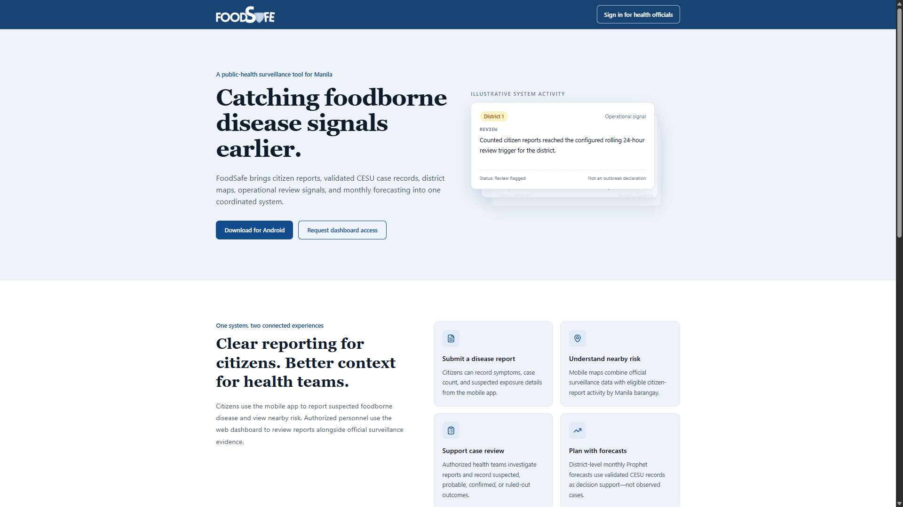
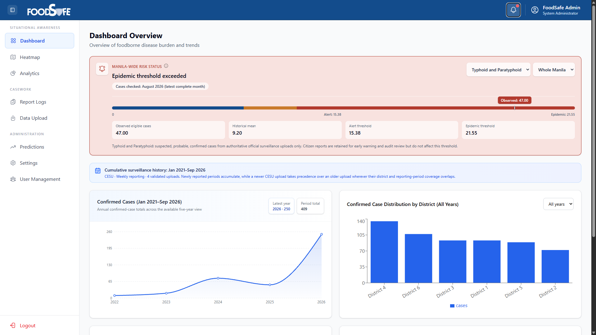
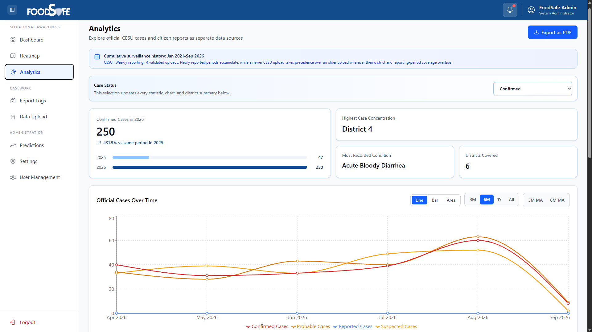
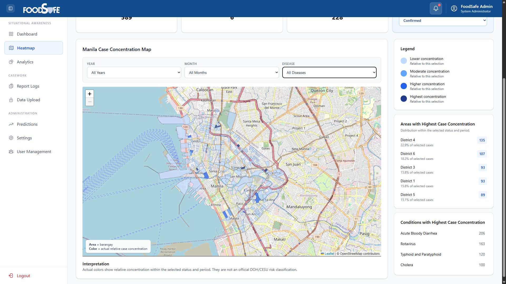
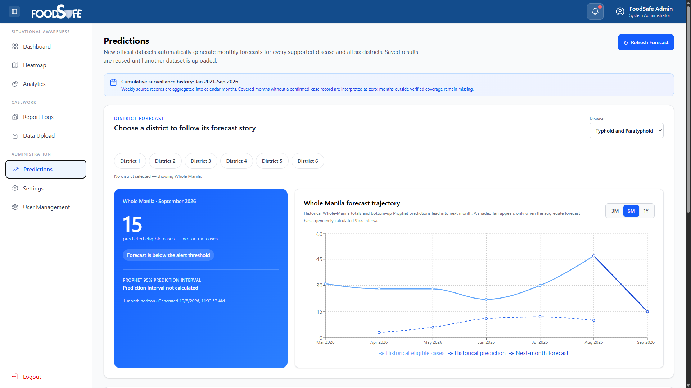
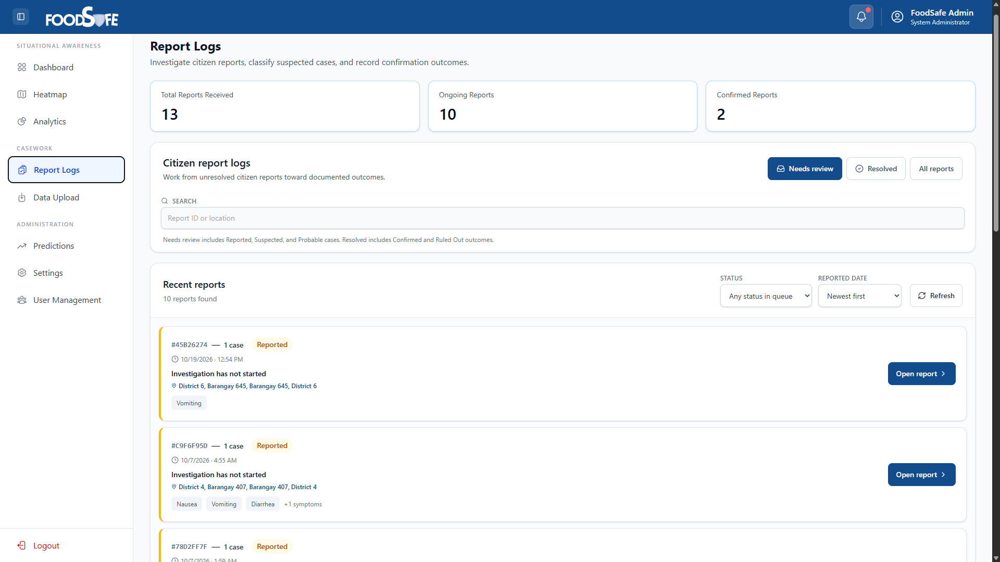
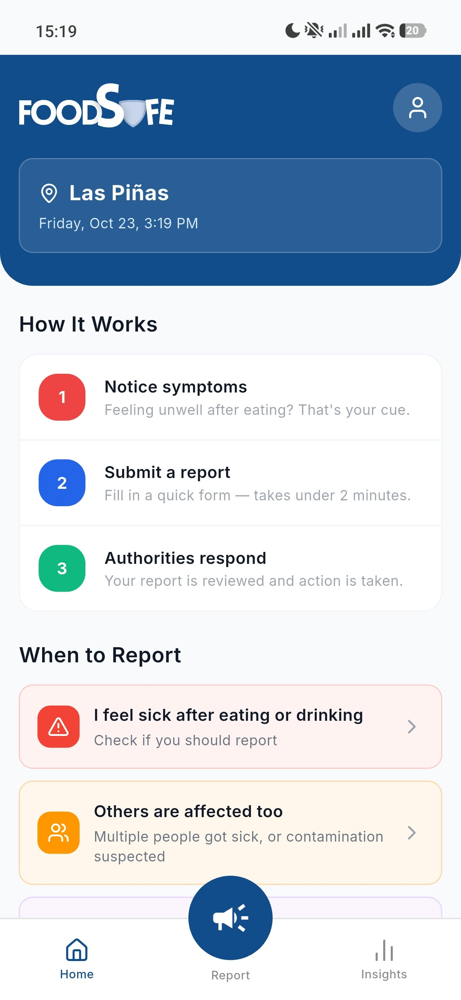
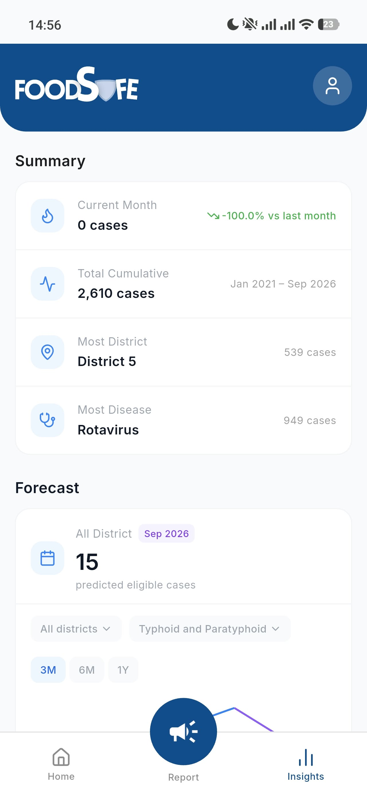
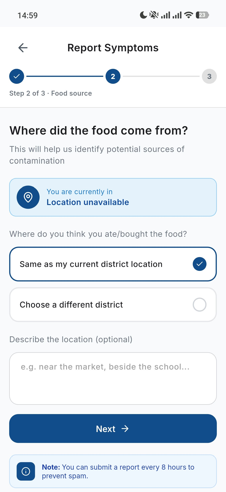
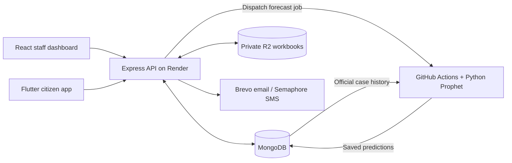

# FoodSafe Manila

**A descriptive and predictive web-and-mobile platform for foodborne illness monitoring in Manila.**

[**Live web application**](https://foodsafe-manila.online) · [**Mobile setup**](mobile/README.md) · [**Forecasting documentation**](docs/forecast-production.md)

> **Academic capstone project — not an official public-health service.** The platform is for research, demonstration, and controlled testing. Maps, analytics, and predictions are not medical advice or official health advisories.

## Project overview

FoodSafe Manila brings together official case datasets, citizen-submitted food-exposure reports, geographic visualization, and monthly forecasting in one system. It consists of a **React administration dashboard**, a **Flutter citizen-facing mobile application**, and a **shared Express API** with MongoDB persistence.

The system maintains an important data boundary: **citizen reports are not automatically treated as verified official cases**. Official case data powers the forecasting series; citizen reports remain a separate reporting and review workflow.

## What the system does

### Web administration dashboard

- View case summaries, historical trends, district and disease breakdowns, and interactive charts.
- Explore district- and barangay-level geographic heat maps.
- Upload and validate official datasets for analysis.
- Inspect monthly district forecasts, forecast history, and model backtesting results.
- Review citizen-submitted reports and their activity history.
- Manage users, access, and operational notifications.

### Citizen mobile application

- Register and sign in using a Philippine mobile number and SMS one-time password.
- Explore case insights, trends, and available predictions.
- Submit guided symptom and food-exposure reports and review report history.
- Find health facilities on a location-aware map, with filters and distance information when location is available.
- Review account settings, policies, and reporting/location disclosures.
- Receive app notifications.

## Screenshots

A selection of **9 screens** highlighting the core web dashboard, predictive capabilities, and mobile reporting experience. Additional screenshots remain available in [docs/screenshots](docs/screenshots/).

### Web application

**Landing page**



**Dashboard and analytics**

| Dashboard | Case analytics |
| --- | --- |
|  |  |

**Geographic monitoring and forecasting**

| Geographic heat map | Monthly predictions |
| --- | --- |
|  |  |

**Citizen report management**



### Flutter mobile application

| Home | Insights | Guided reporting |
| --- | --- | --- |
|  |  |  |

## Technology stack

| Component | Technologies |
| --- | --- |
| Web | React 19, Vite, React Router, Tailwind CSS, Axios |
| Web charts and maps | Recharts, Leaflet, React Leaflet |
| Mobile | Flutter, Dart, `fl_chart`, `flutter_map`, geolocator, geocoding |
| Backend | Node.js, Express 5, MongoDB, Mongoose |
| Security and auth | JWT, bcryptjs, rate limiting, CORS, SMS OTP |
| File processing and storage | Multer, XLSX, private Cloudflare R2 |
| Forecasting | Python Prophet, historical backtesting, Seasonal Naïve benchmark |
| External services | Brevo, Semaphore SMS |
| Hosting and automation | Render, GitHub Actions |

## Architecture



The API is the shared source of truth for both clients. Administrative operations, report workflows, analytics, and predictions are implemented in the backend rather than duplicated in the mobile and web applications.

The diagram represents GitHub execution, required by the Node-only Render backend build. Local development can run Prophet through Python subprocesses instead. The in-process monthly fallback runs only in local mode; the forecasting workflows are dispatch-based. A separate CI workflow checks pull requests and production pushes. See the [detailed architecture](docs/architecture.md).

## Predictive analytics

FoodSafe uses **Prophet** for monthly operational forecasts by Manila district. Its forecasting design includes:

- **District-level predictions:** forecasts are generated for the six Manila districts.
- **Bottom-up city totals:** whole-Manila point forecasts are aggregated from district forecasts.
- **Historical backtesting:** model behavior is evaluated against historical observations.
- **Benchmark comparison:** Seasonal Naïve is a historical benchmark, **not** an automatic production fallback.
- **Data provenance:** unverified citizen reports are not mixed into official confirmed-case forecasting series.

Forecast execution can be dispatched through GitHub Actions. Production activation depends on environment configuration and verification; see [forecast deployment](docs/forecast-production.md) and [forecast testing](docs/forecast-testing.md) for the operational details.

Forecasts are statistical estimates, not guaranteed outcomes or individual risk assessments.

## Repository structure

```text
foodsafe-manila/
├── backend/           # Express API, models, services, tests
├── frontend/          # React administrative web app
├── mobile/            # Flutter citizen application
├── docs/              # Forecast and technical documentation
├── load-tests/        # Performance testing resources
├── render.yaml        # Render service configuration
└── README.md
```

## Local development

**Prerequisites:** Node.js 22.12 or newer within Node 22 with npm, an isolated MongoDB development database, and Flutter with Dart compatible with `^3.10.0` plus Android tooling. Transaction-dependent account flows require a MongoDB replica set or suitable Atlas deployment. Local forecasting additionally requires Python 3.12 and the pinned dependencies.

The commands below use PowerShell from a new checkout. See [local development](docs/local-development.md) for environment variables, integrations, local Python setup, and troubleshooting. Edit existing `.env` files instead of overwriting them.

### Backend

```powershell
cd backend
npm ci
Copy-Item -LiteralPath .env.example -Destination .env
```

Configure the database and replace the sample secrets before starting the API:

```powershell
npm run dev
```

Use [backend/.env.example](backend/.env.example) as the configuration reference. R2 imports/downloads, email/SMS flows, and forecast execution require their corresponding dependencies and credentials. The example selects local forecasting; install its Python environment before exercising forecasts. Never commit real credentials. Staff access requires an approved development account; no working demo account is provisioned by these commands.

### Web

In a separate terminal:

```powershell
cd frontend
npm ci
Set-Content -LiteralPath .env -Value 'VITE_API_BASE_URL=http://localhost:5000'
npm run dev
```

The frontend API value is the backend origin **without `/api`**. Backend `ALLOWED_ORIGINS` must include Vite's exact printed origin. See the [frontend guide](frontend/README.md) for routing, hooks, API integration, charts, and maps.

### Mobile

```powershell
cd mobile
flutter doctor
flutter pub get
flutter run
```

The Android emulator's development API default is documented in [mobile/README.md](mobile/README.md), along with physical-device configuration and release-build requirements.

## Contributors

`irleo` carried out most of the development and integration across the web dashboard, shared backend, mobile app, and forecasting pipeline. `benrichardss` helped with the mobile UI/UX. See the [contribution statement](docs/contributions.md) for scope and attribution.

## Security, privacy, and reliability

The implementation includes JWT-based authentication and refresh flows, password hashing, OTP verification controls, role-aware API access, rate limiting, CORS allowlisting, sanitized production errors, redacted logs, request identifiers, and private object storage.

Mobile reporting uses policy acknowledgements and reporting/location disclosures. **Testing should use simulated symptoms and fictional exposure details**, consistent with the project's private-testing documentation.

The repository also includes automated checks for error disclosure, analytics data boundaries, authentication/report policies, and related defects.

Read [SECURITY.md](SECURITY.md) for private vulnerability reporting and sensitive-data precautions. The [Phase 3 review](docs/security-review.md) records local check results, audit scope, and an unresolved historical-data finding; it does not certify the repository or live deployment as secure.

[FoodSafe CI](.github/workflows/ci.yml) defines frontend lint/tests/build, backend syntax/tests, and synthetic Python forecasting tests. It runs on pull requests targeting `production` and pushes to `production`. Flutter checks are run locally when mobile changes need verification. A successful GitHub run and required-check enforcement must be verified before treating the release gate as active; adding the workflow alone does not configure repository protection.

## Documentation

- [Local development and environment configuration](docs/local-development.md)
- [React dashboard guide](frontend/README.md)
- [Mobile application guide](mobile/README.md)
- [System architecture](docs/architecture.md)
- [Backend API groups and request examples](docs/api.md)
- [Existing checks and test commands](docs/testing.md)
- [Security policy and vulnerability reporting](SECURITY.md)
- [Phase 3 engineering and repository review](docs/security-review.md)
- [Capstone contributions](docs/contributions.md)
- [Deployment overview](docs/deployment-architecture-overview.md)
- [CI workflow, branch protection, and deployment guide](docs/ci-cd-deployment-guide.md)
- [Forecast production workflow](docs/forecast-production.md)
- [Forecast testing](docs/forecast-testing.md)
- [Project documentation](DOCU.md)
- [Private testing privacy](backend/policies/private-testing-privacy.md)
- [Private testing reporting](backend/policies/private-testing-reporting.md)
- [Private testing terms](backend/policies/private-testing-terms.md)

## Project status

FoodSafe Manila is an **academic capstone under active development**. A live web deployment is available for demonstration, but that does not imply all mobile integrations, production forecast workflows, or public-health data feeds are independently verified or officially endorsed.
