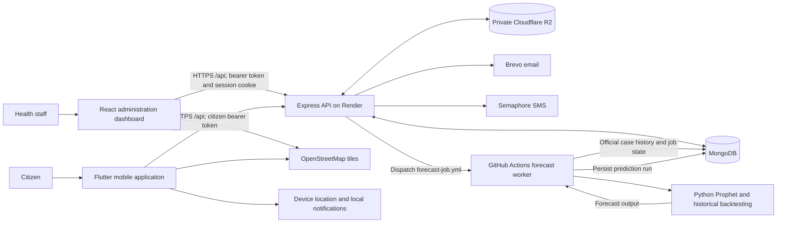

# FoodSafe Manila Architecture

This document describes the checked-in code and [Render Blueprint](../render.yaml). Repository configuration describes the intended deployment; live service settings, credentials, and successful worker activation require separate verification.

## System architecture

The diagram shows `FORECAST_EXECUTION_MODE=github`, required by the Node-only Render build. Local development can use `FORECAST_EXECUTION_MODE=local`; the API then invokes Python subprocesses instead of dispatching Actions.

## Application and data boundaries

| Component | Responsibility |
| --- | --- |
| React dashboard | Staff authentication, official imports, descriptive views, maps, forecasts, report review, account administration |
| Flutter app | Citizen accounts, policy acknowledgements, symptom/exposure reports, public insights, facility maps, local alerts |
| Express API | Authentication, authorization, validation, imports, analytical queries, report workflows, forecast dispatch |
| MongoDB | Accounts, official cases, citizen reports, dataset metadata, prediction runs, policy acknowledgements, OTP state, notifications, audit records |
| Private R2 | `templates/FoodSafe_Template.xlsx` and original workbooks under `datasets/<dataset-id>/` |
| Actions worker | Claims queued prediction runs, reads official history, runs Prophet/backtests, validates and saves results |
| Brevo / Semaphore | Server-side email and SMS verification delivery |

Validated CESU workbooks contribute to authoritative case history. A newer upload takes precedence for overlapping district/reporting-period coverage. Citizen reports support investigation and audit; they do not automatically become official cases or forecasting inputs.

Model definitions explicitly select collections such as `webUsers`, `mobileUsers`, `officialCases`, and `predictionRuns`. Use current models when inspecting storage; do not infer collection names from older documentation.

## Authentication and reporting

Staff log in with email/password and an approved account. The API returns a short-lived access token and sets an HTTP-only session refresh cookie. Citizen login uses phone/password and returns access/refresh tokens for mobile storage. SMS OTP verification supports registration and recovery. Policy versions and reporting/location acknowledgements are enforced by mobile workflows.

Bearer verification checks the persisted account token version. Role and account-type middleware restrict staff and citizen operations. Sensitive report identity access has additional workflow controls. The API applies CORS, rate limits, standardized errors, and request context independently of browser route guards.

## Import and forecasting flow

1. An `admin` or `cesu` user downloads the template and submits a workbook for validation. Upload middleware limits files to 25 MB.
2. Preview checks structure, records, coverage declarations, and duplicates. Its validation token is bound to the workbook, metadata, and user. Upload requires that token and any required acknowledgement of skipped rows.
3. Import stores the original in private R2 and normalized cases/metadata in MongoDB. Authenticated download endpoints stream private objects; historical local-file records still require their original files.
4. In GitHub mode, upload or manual refresh creates/reuses a scoped prediction job and dispatches the configured `testing` or `production` branch. The worker enforces the matching GitHub environment/database configuration.
5. Python computes disease/district forecasts and historical evaluation. The worker validates results before saving. Clients retrieve eligible saved forecasts from the API; import success alone does not establish forecast success.

In local mode, Node orchestrates Python on the API host. The monthly cron runs at `0 1 1 * *` in server time and **skips execution in GitHub mode**. Current workflows have no independent monthly Actions schedule. See [forecast deployment](forecast-production.md) for credentials, permissions, deadlines, and rollout checks.

## Deployment topology

| Boundary | Checked-in configuration |
| --- | --- |
| Branch | Both Render services use `production` |
| Frontend | `foodsafe-frontend`; root `frontend`; build `npm ci && npm run build`; publish `dist`; SPA rewrite |
| Backend | `foodsafe-backend`; root `backend`; build `npm ci`; start `npm start`; `plan: free`; no persistent disk |
| Forecast runtime | Python dependencies installed by Actions, not the Render backend build |
| Health | `/api/health` reports process status/time; it does not probe MongoDB or Prophet |
| Frontend API | Build-time `VITE_API_BASE_URL`, an origin without `/api` |
| Mobile API | `--dart-define=API_BASE_URL=.../api`, required for release builds |
| Browser access | Exact frontend origins in backend `ALLOWED_ORIGINS`; frontend CSP must permit the API host |
| Deploy gate | Both services declare `autoDeployTrigger: checksPass`; general PR/push CI is still missing |

The Blueprint does not establish the live Render dashboard settings. The declared Free backend can sleep while idle; continuous availability cannot be assumed. See [Render Free services](https://render.com/docs/free).

## Repository mapping

| Path | Implementation |
| --- | --- |
| `frontend/src/modules`, `routes`, `context`, `api`, `hooks` | Web features, routing, sessions, API access |
| `mobile/lib/screens`, `services`, `widgets`, `config` | Citizen UI, API/session handling, device features |
| `backend/server.js` | Middleware, route mounting, database startup, scheduler registration |
| `backend/routes`, `controllers`, `middleware` | API contracts and authorization |
| `backend/models`, `services` | Persistence, analytical access, domain operations |
| `backend/services/prophet` | Python forecast implementation |
| `backend/scripts/runGitHubForecastJob.js` | Actions worker entry point |
| `backend/jobs/predictionCron.js` | Local-mode monthly fallback |
| `.github/workflows` | Dispatch-based worker and manual testing trials |

Local-mode queue/cron coordination is process-local. GitHub mode stores scoped job state in MongoDB and uses worker claims and existing indexes. Review both modes before horizontal scaling; their coordination guarantees differ.
